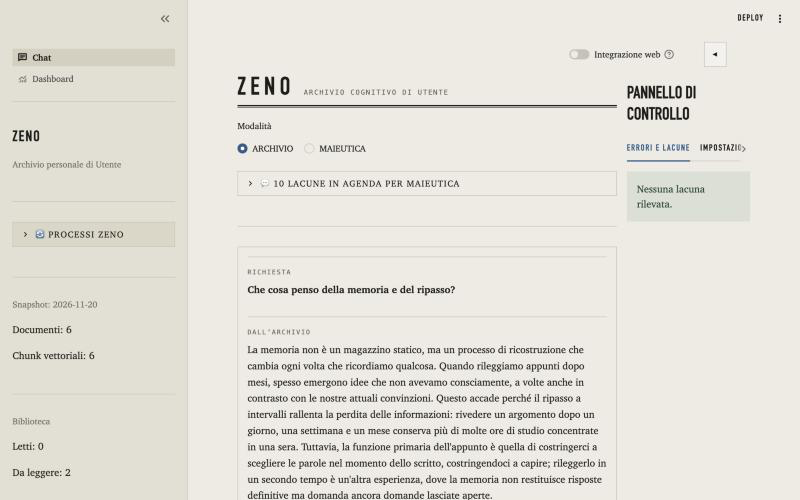
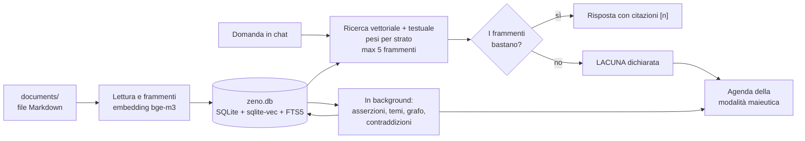

<p align="center">
  
</p>

<h1 align="center">Zeno</h1>

<p align="center">

[](https://doi.org/10.5281/zenodo.24393322)
[](LICENSE)


</p>

**English summary.** Zeno is a research prototype of a personal epistemic
engine, designed as a "cognitive mirror". It reads what one person has written
and read, extracts atomic claims, links them in a graph and points out gaps and
contradictions. In its maieutic mode it asks Socratic questions instead of
answering. Everything runs on the user's own Mac (Apple Silicon): one local
language model (Qwen3.5-4B, 4-bit, via MLX), bge-m3 embeddings, and SQLite with
sqlite-vec and FTS5. No text leaves the computer. On a 30-question test set
built from the author's archive, the current configuration answered 29
questions correctly and recognised all 7 questions the archive could not
answer, with a median of 18.9 s per answer on a MacBook Air M3. It is a
single-user prototype, not a product, and it has not been tested on other
users. The interface and prompts are in Italian. Installation steps are below;
[docs/METODO.md](docs/METODO.md) (in Italian) describes how the design and the
models were chosen.

---

Zeno è un prototipo di ricerca: un motore epistemico personale, pensato come
«specchio cognitivo». Legge ciò che hai scritto e ciò che hai letto, ne estrae
le asserzioni, le collega in un grafo e ti mostra le lacune e le
contraddizioni. Puoi interrogarlo come un archivio, e lui risponde citando i
tuoi documenti. Oppure puoi scegliere la modalità maieutica, in cui Zeno non
risponde e ti fa domande.

Gira tutto sul tuo Mac. I tuoi testi, le domande e le risposte restano sul
computer.



*La chat in modalità ARCHIVIO, su un archivio di prova con testi inventati.*

## Indice

- [Per chi è](#per-chi-è)
- [Che cosa serve](#che-cosa-serve)
- [Installazione](#installazione)
- [Prima di partire: i documenti](#prima-di-partire-i-documenti)
- [Primo uso](#primo-uso)
- [Come funziona](#come-funziona)
- [Risultati e limiti](#risultati-e-limiti)
- [Modelli provati e miglioramenti](#modelli-provati-e-miglioramenti)
- [Rete e dati personali](#rete-e-dati-personali)
- [Comandi da terminale](#comandi-da-terminale)
- [Documentazione](#documentazione)
- [Come citare](#come-citare)

## Per chi è

Zeno serve a chi tiene da anni appunti, riflessioni, recensioni e
conversazioni e vuole vedere come il proprio pensiero si collega e cambia nel
tempo. Ha un solo utente e un solo archivio. Non addestra alcun modello:
quando aggiungi documenti migliora il recupero delle informazioni, mentre i
pesi del modello restano quelli originali.

L'ha scritto una persona sola, per la tesi di Master di II livello in
Intelligence (a.a. 2025/2026) e per il proprio archivio. Il percorso, le scelte
e le misure sono in [docs/METODO.md](docs/METODO.md).

## Che cosa serve

- Un Mac con Apple Silicon (M1 o successivi). Zeno è provato su un MacBook Air
  M3 con 16 GB di memoria. Il modello occupa circa 3 GB mentre lavora.
- Circa 6 GB liberi sul disco: 4 GB per i modelli, il resto per l'ambiente
  Python.
- [Homebrew](https://brew.sh) e il suo Python, versione 3.12 o più recente. Il
  Python di sistema di macOS non va bene, perché il suo SQLite non carica
  estensioni.
- La connessione a internet, solo per l'installazione.

Linux e Windows non sono supportati: i modelli girano con MLX, che esiste solo
per Apple Silicon.

## Installazione

Apri il Terminale e incolla un blocco alla volta.

**1. Homebrew e Python.** Se hai già Homebrew, salta il primo comando.

```bash
/bin/bash -c "$(curl -fsSL https://raw.githubusercontent.com/Homebrew/install/HEAD/install.sh)"
```

```bash
brew install python@3.14
```

Facoltativo, serve solo per leggere i PDF fatti di immagini:

```bash
brew install tesseract tesseract-lang
```

**2. Scarica Zeno.** Zeno vive in una cartella sua, qui `~/Zeno`. Il codice va
nella sottocartella `scripts`.

```bash
mkdir -p ~/Zeno && cd ~/Zeno
git clone https://github.com/Lupini97/zeno-cognitive-mirror.git scripts
```

**3. Installa.** Lo script controlla il Mac, crea l'ambiente Python, le
cartelle e il file di configurazione, poi scarica i due modelli (circa 4 GB,
una volta sola).

```bash
cd ~/Zeno/scripts && ./installa.sh
```

Puoi rilanciarlo quando vuoi: non sovrascrive configurazione, documenti o
archivio.

**4. Scrivi il tuo nome.** Zeno ti chiama con il nome che trova in
`identita.nome_utente`. Apri la configurazione:

```bash
open -e ~/Zeno/zeno_config.yaml
```

e cambia `nome_utente: Utente` con il tuo nome. Salva e chiudi.

Zeno ordina le asserzioni in temi. Parte con dieci temi generici (lavoro,
studio, scrittura, società, scienza, filosofia, storia, arte, relazioni,
salute). Dalla scheda «Gestione temi» della dashboard li rinomini, ne crei e ne
ritiri, e Zeno ne propone di nuovi quando legge i tuoi documenti. Se preferisci
partire dai tuoi, scrivili in `temi.iniziali` prima del primo avvio: il file
contiene un esempio.

Alla fine `~/Zeno` contiene:

```
~/Zeno/
├── scripts/            il codice
├── .venv_zeno/         l'ambiente Python
├── zeno_config.yaml    la tua configurazione
├── documents/          i tuoi documenti
├── models/             i pesi dei modelli
├── stats/              registri, valutazioni, lacune
└── zeno.db             l'archivio, creato al primo avvio
```

## Prima di partire: i documenti

Zeno lavora solo su ciò che gli dai. Con l'archivio vuoto non ha niente da
citare, niente da collegare e nessuna domanda da farti. Prima del primo avvio
conviene caricare un nucleo di documenti: qualche decina di tuoi testi
(appunti, riflessioni, articoli che hai scritto) e qualche scheda o sintesi di
ciò che hai letto. Potrai aggiungerne altri quando vuoi: Zeno li legge a ogni
avvio.

**Usa il Markdown.** Zeno legge solo file `.md`. Se i tuoi documenti sono in
PDF, Word, PowerPoint o Excel, conviene convertirli prima, fuori da Zeno, con
uno strumento come [MarkItDown](https://github.com/microsoft/markitdown)
(Microsoft, licenza MIT). Conserva titoli, elenchi e tabelle, e ti lascia
controllare il risultato prima di darlo a Zeno.

Installa MarkItDown in un ambiente suo, separato da quello di Zeno:

```bash
python3.14 -m venv ~/.markitdown && ~/.markitdown/bin/pip install 'markitdown[pdf,docx,pptx,xlsx]'
```

Converti un file:

```bash
~/.markitdown/bin/markitdown documento.pdf -o documento.md
```

Oppure tutti i PDF e i DOCX di una cartella, per esempio `~/Desktop/da_convertire`:

```bash
cd ~/Desktop/da_convertire && bash -c 'for f in *.pdf *.docx; do [ -e "$f" ] && ~/.markitdown/bin/markitdown "$f" -o "${f%.*}.md"; done'
```

Apri qualche `.md` e controlla che il testo ci sia. I PDF fatti di immagini
(scansioni) di solito escono vuoti: per quelli usa il convertitore di Zeno,
che legge le immagini con Tesseract (vedi sotto).

**Dai una data e un titolo.** Zeno usa la data per seguire come cambia il tuo
pensiero. La prende, nell'ordine, dal frontmatter, dal nome del file
(`2025-03-12 Appunti.md`) e solo alla fine dalla data di modifica del file,
che dopo una conversione è quella di oggi. Il titolo lo prende dal frontmatter
o dal primo titolo `#` del testo. Un'intestazione così basta:

```markdown
---
title: Appunti sulla memoria
date: 2025-03-12
---
```

**Metti ogni file nella cartella giusta.** Zeno legge i file dentro
`~/Zeno/documents/`. La cartella decide lo strato di conoscenza, e quindi
quanto pesa il documento nelle risposte:

| Cartella | Che cosa ci va | Strato |
|---|---|---|
| `riflessioni/`, `pubblicazioni/` | ciò che hai scritto tu | esplicito (peso massimo) |
| `libri/`, `articoli_saggistica/`, `formazione/` | ciò che hai letto o studiato | acquisito |
| `chatgpt/`, `gemini/` (creale tu) | conversazioni archiviate | dialogico |

**In alternativa, il convertitore di Zeno.** Metti PDF, DOCX, HTML o TXT
direttamente nelle cartelle di `documents/` e lancia il comando qui sotto.
Zeno scrive il `.md` accanto a ogni file e sposta l'originale in
`~/Zeno/documents_originali/`. Per le scansioni usa Tesseract, se l'hai
installato.

```bash
cd ~/Zeno/scripts && ../.venv_zeno/bin/python -m zeno_engine converti
```

## Primo uso

**1. Prepara i documenti** come spiegato nella sezione precedente.

**2. Avvia Zeno.**

```bash
~/Zeno/scripts/avvia_zeno.sh
```

Poi apri nel browser la chat, <http://localhost:8501>, e la dashboard,
<http://localhost:8502>.

Al primo avvio Zeno legge i documenti e calcola gli embedding. Poi, mentre
l'app è aperta e non la usi, estrae le asserzioni, assegna i temi e costruisce
il grafo. Su qualche decina di documenti bastano pochi minuti; su un archivio
di migliaia di file servono ore, distribuite su più avvii. La prima risposta
dopo l'avvio è più lenta, perché Zeno carica il modello in memoria.

**3. Usa la chat.** In alto scegli la modalità:

- **ARCHIVIO**: fai una domanda e Zeno risponde citando i documenti con
  numeri fra parentesi quadre, che rimandano all'elenco delle fonti. Se i
  documenti non bastano, scrive `LACUNA:` e dice che cosa manca. Ogni lacuna
  finisce nell'agenda della modalità maieutica. Sotto ogni risposta puoi dare
  un pollice su o giù.
- **MAIEUTICA**: Zeno non risponde, ti fa domande. Parte dall'agenda: le
  lacune aperte, i collegamenti da confermare, le tensioni fra i temi. Quando
  nel dialogo cambi posizione, lo segna con `EVOLUZIONE:`. A fine sessione ti
  propone una nota, che puoi correggere e salvare.

L'interruttore «Integrazione web», in alto nella chat, decide se Zeno può
usare internet. È spento di serie: Zeno non cerca e non scarica nulla. Se lo
accendi, accanto alle lacune funzionano «Cerca sul web» e «Importa pagina»,
in chat e in dashboard, e partono solo quando premi il pulsante.

**4. Guarda la dashboard.** Le schede mostrano statistiche dell'archivio, il
grafo in 3D, il diario settimanale, l'evoluzione nel tempo, i temi (da
confermare o rifiutare), le lacune aperte (da eliminare o unire), le entità e
il profilo cognitivo, che resta vuoto se non lo compili.

**5. Ferma Zeno.** Chiudere il browser non basta: chat, dashboard e modello
restano attivi in background. Per fermarli:

```bash
lsof -ti tcp:8501,8502,11500 | xargs kill
```

## Come funziona



**Archivio.** Un solo file SQLite, `zeno.db`, contiene frammenti, embedding,
asserzioni, entità, temi e archi del grafo. sqlite-vec fa la ricerca
vettoriale, FTS5 quella per parole. Se cancelli `zeno.db`, l'avvio successivo
rilegge i documenti e ricalcola gli embedding; asserzioni e temi si rifanno in
background.

**Modelli.** Un solo modello linguistico, `mlx-community/Qwen3.5-4B-4bit`,
scrive le risposte, estrae le asserzioni e assegna i temi.
`mlx-community/bge-m3-mlx-fp16` calcola gli embedding. Girano con MLX dentro un
demone locale (`127.0.0.1:11500`), che tiene in memoria una copia sola del
modello per tutti i processi di Zeno. Un vincolo di grammatica (llguidance)
obbliga il modello a produrre JSON valido nelle estrazioni. Puoi cambiare
modello in `zeno_config.yaml`, con un altro in formato MLX.

**Quattro strati di conoscenza.** Nel recupero ogni frammento riceve un peso
secondo lo strato: esplicito 1,5 (ciò che hai scritto), inferito 1,3 (sintesi
di Zeno), dialogico 1,1 (conversazioni), acquisito 1,0 (ciò che hai letto). La
tua voce viene prima di quella dei libri.

**Una risposta.** Zeno combina la ricerca vettoriale e quella per parole,
applica i pesi, scarta i frammenti quasi identici e ne passa al modello al
massimo cinque, non più di due per fonte. Il primo risultato della ricerca per
parole ha sempre un posto. Poi il modello lavora in due chiamate. La prima
decide soltanto se i frammenti bastano. Se bastano, la seconda scrive la
risposta citando i documenti; se non bastano, Zeno dichiara la lacuna invece di
colmarla con ciò che il modello sa per conto suo.

**In background.** Quando l'app è aperta e non la usi da dieci minuti, Zeno
estrae le asserzioni dai frammenti nuovi, propone temi, aggiorna il grafo
(NetworkX, comunità di Louvain), cerca contraddizioni fra le tue asserzioni e
prepara ogni giorno un briefing con tre domande socratiche e qualche argomento
vecchio da ripassare.

**Interfaccia.** Streamlit, con chat e dashboard. Il grafo 3D usa una libreria
JavaScript inclusa nel repository: l'interfaccia non carica nulla da internet.

Struttura del codice:

```
scripts/
├── chat_ui.py, dashboard.py, zeno_app.py   pagine Streamlit
├── avvia_zeno.sh, installa.sh               avvio e installazione
├── zeno_launcher.py                         finestra dell'app (pywebview)
├── zeno_engine/                             il motore: python -m zeno_engine <comando>
│   ├── config.py                            unico lettore di zeno_config.yaml
│   ├── ingest, archivista, indicizzatore    lettura, asserzioni, embedding e temi
│   ├── ask, adapter_v5, prompt_chat         recupero e risposta
│   ├── critico, briefing, graph, lacune     contraddizioni, briefing, grafo, lacune
│   ├── sync, periodici                      messa in pari e lavori in background
│   ├── mlx_server, mlx_motore, mlx_embed    demone e modelli MLX
│   └── valutazione                          misura della qualità (zeno valuta)
├── interfaccia/                             tema, grafo 3D, finestra, aggiornamenti
├── docs/                                    metodo e immagini
└── tests/                                   test con dati inventati
```

## Risultati e limiti

L'autore ha misurato le risposte su 30 domande reali poste al proprio
archivio, ognuna con la risposta attesa scritta da lui. Sette domande
riguardano cose che l'archivio non contiene: lì la risposta giusta è la
lacuna. Un modello locale (Qwen3-4B-Instruct-2507) ha fatto da giudice, con
punteggi da 0 a 2.

| Misura | Configurazione attuale |
|---|---|
| Risposte corrette | 29 su 30 |
| Copertura della risposta attesa (0-2) | 1,91 |
| Fedeltà ai documenti (0-2) | 1,93 |
| Lacune riconosciute | 7 su 7 |
| Lacune segnalate a torto | 2 |
| Tempo per risposta (mediana) | 18,9 s |
| Prima parola a schermo | circa 13 s |
| Brano giusto fra i frammenti passati al modello | 21 su 23 |

Tempi misurati su un MacBook Air M3 da 16 GB, a modello già caricato. Prima
del lavoro sulle istruzioni e sul recupero la stessa misura dava 52 secondi di
mediana. Una lettura esterna una tantum (Claude, 17 novembre 2026, sulle
configurazioni di prova) ha dato fedeltà più basse del giudice locale. Numeri,
metodo e storia sono in [docs/METODO.md](docs/METODO.md).

Limiti da tenere presenti:

- Le misure vengono da un solo archivio, da 30 domande e dalla persona che ha
  scritto il programma. Indicano una tendenza e non dimostrano nulla in
  generale.
- Il giudice è un modello piccolo, della stessa famiglia di quelli giudicati.
  Tende a premiare le risposte lunghe, quindi la fedeltà può essere
  sovrastimata.
- I test automatici coprono il guardiano del demone e la gestione delle
  lacune, non tutto il sistema.
- Interfaccia e istruzioni al modello sono in italiano.
- Zeno ha un solo utente. Un uso con più persone, per esempio in una scuola,
  è una proposta della tesi e non è stato costruito.

## Modelli provati e miglioramenti

Zeno è cambiato molto fra giugno e novembre 2026. Gli schemi interni hanno due
nomi, V5 e V6; le versioni pubblicate del software si chiamano 0.2.0, 0.2.1, 0.2.2 e
così via.

| Periodo | Schema | Modello linguistico | Embedding | Esecuzione |
|---|---|---|---|---|
| fino a luglio 2026 | V5 | Llama 3.1 8B | nomic-embed-text v1.5 | Ollama, LlamaIndex, Qdrant |
| luglio-settembre | V6 | Qwen2.5 3B (classifica), Llama 3.1 8B (estrae), Qwen2.5 7B (risponde) | bge-m3 | Ollama, SQLite |
| 6 settembre-17 novembre | V6 | Qwen3-4B-Instruct-2507 per tutto | bge-m3 | MLX |
| 17-18 novembre | V6 | Qwen3.5-4B risponde, Qwen3-4B-2507 estrae | bge-m3 | MLX |
| dal 18 novembre (0.2.x) | V6 | Qwen3.5-4B per tutto | bge-m3 | MLX |

Provati e scartati: Qwen3-8B (a settembre degenerava nell'estrazione, a
novembre ha inventato 3 risposte su 30), Qwen3.5-9B (stessa qualità di
estrazione, metà velocità, memoria quasi tripla), il reranker
bge-reranker-v2-m3 (migliora il recupero, non le risposte), tre modelli
esterni per la sola decisione «i documenti bastano?» (nessuno meglio del
modello già in memoria).

Come sono cambiate le prestazioni principali:

| Misura | Prima | Dopo |
|---|---|---|
| Tempo per risposta | 35-120 s (Ollama, luglio) | 26-47 s (MLX, settembre); 18,9 s di mediana sul set di prova (novembre) |
| Estrazione delle asserzioni | circa 41 s a frammento (Llama 3.1 8B su Ollama) | circa 21 s (Qwen3.5-4B su MLX) |
| Memoria del modello | 4,2 GB (Llama 3.1 8B) | circa 3 GB (Qwen3.5-4B) |
| Risposte corrette sul set di prova | 26/30 (Qwen3.5-4B, istruzioni iniziali) | 29/30 |
| Lacune riconosciute | 3/7 | 7/7 |
| Fedeltà ai documenti (giudice locale) | 1,70 (configurazione iniziale) | 1,93 |
| Brano giusto passato al modello | 19/23 | 21/23 |

Le misure di luglio e settembre vengono da poche domande; quelle di novembre
dal set di 30. Le tabelle complete, il metodo e i limiti sono in
[docs/METODO.md](docs/METODO.md).

## Rete e dati personali

Dettagli in [PRIVACY.md](PRIVACY.md). In breve: i tuoi testi non lasciano il
computer e il codice non chiama alcun servizio di intelligenza artificiale
esterno. La rete serve a scaricare i modelli, a controllare ogni 30 giorni se
ci sono versioni nuove e, solo se accendi «Integrazione web», a cercare sul
web o a scaricare una pagina quando lo chiedi tu. I primi due si spengono da
`zeno_config.yaml`, sezione `rete`. Chat e dashboard
ascoltano solo su `localhost`.

## Comandi da terminale

Tutti i comandi partono dalla cartella `scripts`:

```bash
cd ~/Zeno/scripts
```

Fai una domanda senza aprire la chat:

```bash
../.venv_zeno/bin/python -m zeno_engine ask "che cosa ho scritto sulla memoria?"
```

Metti in pari l'archivio con i documenti (file nuovi, modificati o tolti):

```bash
../.venv_zeno/bin/python -m zeno_engine sync
```

Guarda quanti documenti, frammenti e asserzioni ci sono:

```bash
../.venv_zeno/bin/python -m zeno_engine audit
```

Elenca tutti i comandi:

```bash
../.venv_zeno/bin/python -m zeno_engine --help
```

Per misurare Zeno sul tuo archivio, con le tue domande, vedi
[docs/METODO.md](docs/METODO.md#rifare-le-misure-sul-tuo-archivio).

Test automatici, su dati inventati:

```bash
cd ~/Zeno/scripts && ../.venv_zeno/bin/python -m unittest discover -s tests -t . -v
```

## Documentazione

| File | Che cosa contiene |
|---|---|
| [README.md](README.md) | che cos'è Zeno, installazione, primo uso, sintesi dei risultati |
| [docs/GUIDA.md](docs/GUIDA.md) | guida dettagliata: chat, dashboard, lavori in background, configurazione, comandi, problemi comuni |
| [docs/METODO.md](docs/METODO.md) | come si è arrivati a Zeno: storia, scelta dei modelli, misure, verifica esterna, limiti |
| [PRIVACY.md](PRIVACY.md) | che cosa esce dal computer e che cosa resta |

## Come citare

Michele Modesto (2026). *Zeno: prototipo di ricerca di motore epistemico
personale* (versione 0.2.2). Zenodo. https://doi.org/10.5281/zenodo.24393322

Il DOI qui sopra raccoglie tutte le versioni e porta sempre all'ultima. Le
versioni precedenti hanno un DOI proprio: 0.2.1
https://doi.org/10.5281/zenodo.24398096, 0.2.0
https://doi.org/10.5281/zenodo.24393323. I metadati sono in
[CITATION.cff](CITATION.cff): GitHub li mostra nel pulsante «Cite this
repository».

## Licenza

[MIT](LICENSE).
